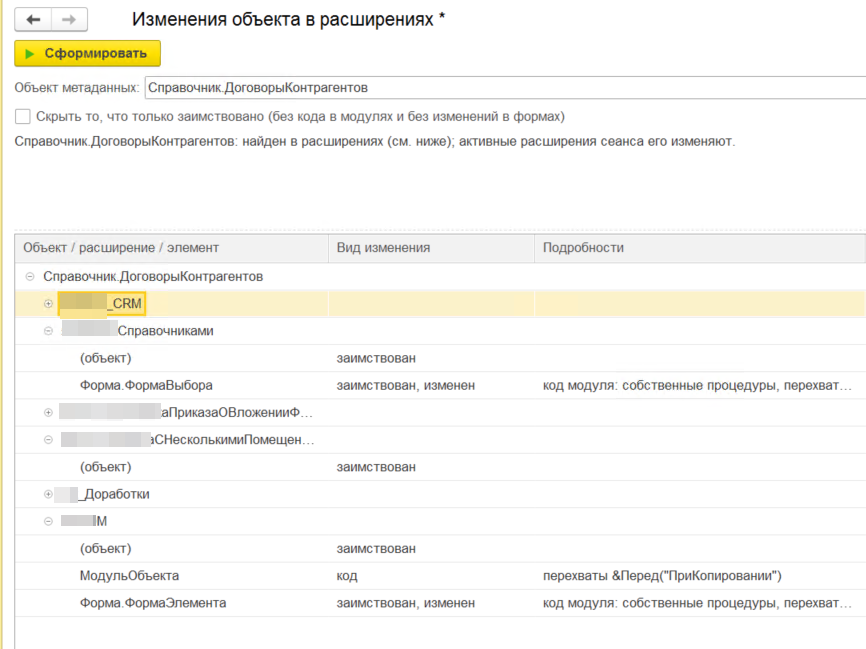

# Инструменты разработки и администрирования 1С

Внешние обработки, отчёты и другой код, которые помогают разрабатывать и администрировать
информационные базы на платформе 1С:Предприятие 8.3.

## Состав

| Инструмент | Вид | Назначение |
|---|---|---|
| [Изменения объекта в расширениях](#изменения-объекта-в-расширениях) | внешняя обработка | Какие расширения базы изменяют выбранный объект метаданных и что именно в нём меняют |

## Структура репозитория

```
src/
├── epf/   # внешние обработки: <Имя>.xml + каталог <Имя>/ (выгрузка в XML)
└── erf/   # внешние отчёты
```

Исходники хранятся в формате выгрузки XML (формат 2.20, платформа 8.3.27).
Готовые `.epf` и `.erf` прикладываются к [релизам](../../releases).

## Сборка из исходников

В Конфигураторе любой базы на платформе 8.3.27 или новее:
*Файл → Открыть* корневой XML-файл, затем *Файл → Сохранить как* `.epf`.

Или из командной строки:

```bat
"C:\Program Files\1cv8\8.3.27.2342\bin\1cv8.exe" DESIGNER /F "<каталог любой файловой базы>" ^
  /LoadExternalDataProcessorOrReportFromFiles "src\epf\ИзмененияОбъектаВРасширениях.xml" ^
  "build\ИзмененияОбъектаВРасширениях.epf" /DisableStartupDialogs
```

---

## Изменения объекта в расширениях

`src/epf/ИзмененияОбъектаВРасширениях`

Показывает, какие расширения информационной базы, в том числе отключённые, изменяют выбранный
объект метаданных, и что именно в нём меняют.



### Как пользоваться

1. Откройте обработку в режиме 1С:Предприятие: *Файл → Открыть*. Пользователь должен иметь
   административные права, иначе список расширений не прочитать.
2. Выберите объект в поле «Объект метаданных» или введите полное имя, например
   `Справочник.ДоговорыКонтрагентов`. Пустое поле означает все объекты всех расширений.
3. Нажмите «Сформировать» (Ctrl+Enter).

Результат выводится деревом «объект → расширение → элемент». Для расширения показываются синоним,
версия, активность, безопасный режим, изменение структуры данных и назначение. Для элементов
указан вид изменения:

| Вид изменения | Что значит |
|---|---|
| новый | реквизит, табличная часть, форма, команда и т. п. добавлены расширением |
| заимствован | элемент заимствован без изменений |
| заимствован, изменен | у заимствованной формы есть код в модуле или изменены элементы, реквизиты, команды, обработчики |
| код | в модуле объекта, менеджера или команды есть код; в «Подробностях» перечислены перехваты `&Перед`, `&После`, `&Вместо`, `&ИзменениеИКонтроль` |
| изменена | изменена заимствованная общая форма |

Флажок **«Скрыть то, что только заимствовано»** убирает объекты, которые расширение только
заимствует: у них нет своих элементов, нет кода в модулях и не изменены формы. Заимствованные
элементы без изменений при этом тоже скрываются.

### Вызов из кода или отладчика

```bsl
Обработка = ВнешниеОбработки.Создать("<путь>\ИзмененияОбъектаВРасширениях.epf", Ложь);
Таблица = Обработка.ИзмененияОбъекта("Справочник.ДоговорыКонтрагентов", Истина);
```

`ИзмененияОбъекта(ПолноеИмя = "", ТолькоИзменения = Ложь)` возвращает таблицу значений с колонками
Объект, Расширение, Синоним, Версия, Активно, БезопасныйРежим, ИзменяетСтруктуруДанных, Назначение,
Элемент, ВидИзменения, Подробности. В отладчике выражение можно вычислить через Shift+F9.

### Как это устроено

- Состав объекта берётся из метаданных расширения:
  `Новый ОбъектМетаданныхКонфигурация(Расширение.ПолучитьДанные())`, новый элемент или
  заимствованный определяется по `ПринадлежностьОбъекта`.
- Код модулей и изменения форм читаются из двоичных данных расширения (контейнер `.cfe`).
  Записи контейнера сжаты deflate без заголовка, а встроенный язык такое сжатие не распаковывает.
  Поэтому записи кладутся в ZIP без контрольной суммы и извлекаются `ЧтениеZipФайла`: платформа
  записывает файл целиком и только потом сообщает об ошибке контрольной суммы.
- Заимствованная форма без изменений в расширении имеет пустой модуль, а её описание совпадает
  с описанием базовой формы.

### Ограничения

- Распаковка опирается на недокументированное поведение `ЧтениеZipФайла`; проверено на платформе
  8.3.27. Если данные расширения прочитать не удалось, объект не скрывается, а в «Подробностях»
  указана причина.
- Добавление своих объектов в заимствованные подсистемы, определяемые типы и функциональные
  опции не анализируется.
- Кодом считается любая строка модуля, кроме пустых строк, комментариев и инструкций
  препроцессора (`#`).
